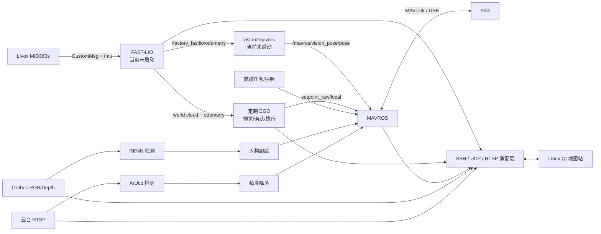

# 科研飞行平台：现场结构与 ROS2 迁移建议

检查日期：2026-11-16，Asia/Shanghai。机载电脑：`orangepi@192.168.1.235`。本轮完成部署检查与迁移设计，未安装 ROS2、未修改机载工程、服务或飞控参数，未启动定位、控制或飞行任务。

## 结论

平台可以分阶段迁移，但不能用一套上游 ROS2 工程直接替换现场系统。Livox、Orbbec、MAVROS、FAST-LIO 和 EGO 均有可评估的 ROS2 实现；现场的定位转发、规划预览/人工确认、PX4 执行器、航点、ArUco 降落、人物跟踪与地面站适配需要保留定制逻辑并逐项验证。

按用户在本轮检查后确定的选择，目标改为 **原生 Ubuntu 22.04 ARM64 + ROS2 Humble**。优先评估 Orange Pi **5 Ultra 专用 Jammy 镜像**，先在独立介质验证板卡启动、NPU、MPP/RGA、USB/相机，再逐模块迁移。用户已选择SD启动安装、Ubuntu22.04最终写入eMMC；ROS1基线通过已有完整恢复镜像与源码副本保留；不对当前系统原地升级，不强制经过24.04或容器路线。Humble 官方支持至2027-05，生命周期较短这一事实保留，但不改变用户指定目标。具体系统准备见 [Ubuntu22.04原生路线](ubuntu22_native_plan.md)。

本轮发现的关键事实：

- 实际工程已集中到 `~/drone_platform/`，旧 `~/something1017/TECH` 和 `~/lidar_tools/start_lidar_localization.sh` 已不存在。这是现场原状，本轮没有移动或删除它们。
- `Safina_sensor.service` 正在提供传感器和 MAVROS；FAST-LIO、位姿转发、EGO 和任务控制当前未运行。不能把有订阅者的话题当作有效数据源。
- 12 秒采样得到 Livox 点云约 **10.00 Hz**、Livox IMU 约 **200.01 Hz**、飞控本地位姿约 **30.00 Hz**。**没有测得当前 FAST-LIO 或视觉转发频率**；转发的配置值为 30 Hz。
- 飞控已连接且未解锁；所采样状态为 `AUTO.LOITER`、`landed_state=1`。估计器水平位置/速度有效标志为 false，未证明雷达定位已被接收和融合。
- Orbbec 的彩色、深度、左右 IR 以及云台 RTSP 都取得了图像。深度与 IR 已通过标准 ROS 订阅核实可读；最初直接 TCPROS 探测的无帧结果不能当作相机故障，也不能据短时取帧判定持续性能已达标。
- 现场存在多个 SDK/运行库版本，必须以实际二进制依赖为准：Orbbec 活动版本 2.10.6；人物检测链接工程自带 RKNN Runtime 2.3.2，而系统目录另有 1.4.0。

## 系统与运行基线

| 项目 | 本次现场结果 |
|---|---|
| 主机/硬件 | `orangepi5ultra`，设备树 `RK3588 OPi 5 Ultra`，aarch64 |
| 系统 | 厂商 `Orange Pi 1.0.0 Focal`，Ubuntu 20.04.6 |
| 内核 | `5.10.160-rockchip-rk3588` |
| 内存/根盘 | 7.8 GiB；`/dev/mmcblk1p2`，约 57G，总可用约 43G |
| ROS | Noetic；MAVROS deb 1.20.1；OpenCV 4.2 |
| 网络 | WLAN `192.168.1.235/23`，有线 `192.168.1.50/24`，云台网卡 `192.168.144.100/24` |
| 雷达 | 驱动 `msg_MID360s.launch` / `MID360s_config.json`，`dev_type=35`，消息 `livox_ros_driver2/CustomMsg` |
| 相机 | USB `2bc5:0804`，Gemini 335L，USB3 5000M；设备固件 1.4.60，SDK/wrapper 2.10.6 |
| 飞控 | USB `1b8c:0036`，HKUST UAV NxtPX4，`/dev/ttyACM0:57600` |
| PX4 版本证据 | MAVROS 日志 `Flight software 011000ff`（版本编码对应 1.16.0 release），custom version 原值 `6ea3539157000000`；不据此推断与本机任一 PX4 源码树完全相同 |
| NPU | rknpu 内核模块 0.9.6；检测程序链接工程内 Runtime 2.3.2 |
| 视频 | MediaMTX `gimbal-rtsp-relay.service`；机载 `rtsp_hw_pub_ultra` 使用 Rockchip MPP/RGA |

12:00 首轮检查之后连接中断，用户继续时机载已重启。恢复时墙钟由约 12:17 校正到 14:26，chrony 随后同步；MAVROS 日志也报告过 time jump。两次 boot 的 PID 和启动时间不能混用。后续实验应记录 boot ID、单调时钟和采集时间戳。

## 实际工程与启动关系

| 路径（均在 `~/drone_platform` 下） | 用途与证据 | 迁移处理 |
|---|---|---|
| `02_drivers/sensors` | catkin 安装空间，含 Livox、to_mavros、usb_cam 与旧 Orbbec；服务从这里启动 | 保存安装包、配置、二进制摘要；部分驱动缺源，不能把它当完整源码树 |
| `02_drivers/orbbec` | 独立相机 workspace；实际进程和 `LD_LIBRARY_PATH` 指向它，版本 2.10.6 | 以此版本及设备固件为基准 |
| `01_apps/fast_lio` | 配置、进程管理器与 `workspace/src/fast_lio`；当前停用但为现有地面站定位入口 | 保留速度补丁、重映射、会话校验和实际参数 |
| `01_apps/ego_planner` | 定制 EGO、预览/确认、PX4 执行器、录制与回放目录 | 保留整个业务接口；不能仅换上游 planner |
| `01_apps/mission_demo` | 航点、ArUco、降落、检测、跟踪、RTSP 与机载任务管理器 | 分成算法核、ROS 接口、任务管理三层迁移 |
| `01_apps/basic_demo` | 教学/基础例程，服务启动中仍 extend 其环境 | 不认定为无用备份；按具体包是否被引用分类 |
| `03_tools/install_assets` | SDK/依赖安装素材 | 不是活动驱动的唯一版本依据 |
| `04_data/flight_records` | 指向 EGO 下 `flight-records` 的链接 | 保留旧数据、ROS1 bag 查看与录制流程 |
| `fast_lio/runs`、`active-*.json` | 历史启动日志与进程记录；当前记录中的 PID 来自旧运行 | 只能作历史证据，需 boot/PID/start tick 验证 |

本次扫描上述部署树没有 Git 元数据。已计算文本与关键二进制 SHA256，保存 603 份机载文本文件与 233 份地面站文本文件。它们是本次迁移基线，不以目录名或 `version=0.0.0` 代替版本识别。原有 `mission_demo/SHA256SUMS` 含 NUL，不能作为有效校验清单。

`Safina_sensor.service` 为 enabled/active，入口：

`02_drivers/sensors/share/livox_ros_driver2/scripts/Safina_sensor.sh`

顺序为 MAVROS → Orbbec → usb_cam → Livox → RTSP。FAST-LIO 与 `to_mavros` 两段处于注释状态。该脚本会清理旧相机进程和设备锁，不能为了 ROS2 测试直接重跑；本轮只读取了文件。

## 数据、坐标与任务链路

以下图表示现有软件连接；其中定位、规划与任务控制在本轮快照中未启动：

实际 FAST-LIO 管理器将 `/Odometry`、`/cloud_registered`、`/cloud_registered_body` 分别重映射为 `/factory_fastlio/odometry`、`/factory_fastlio/cloud_world`、`/factory_fastlio/cloud_body`。TF 也重映射到 **`/factory_fastlio/tf`**，不能假定它在全局 `/tf`。

LIO 的父帧为 `camera_init`、子帧为 `body`。现场源码已把线速度写为 body 坐标；EGO 的 `odom_vel_is_body=true` 再将它转到世界系。迁移时两端必须配套，不能在新节点里重复旋转或直接复制上游的速度输出。

机载在用参数是 `fast_lio/config/lidar.yaml`，其 `time_sync_en=true`、噪声、盲区等与源码树 `config/mid360.yaml` 模板不同。雷达静止 IMU 的加速度模长约 1，体现当前接口的 g 量级；ROS2 驱动/算法需要对照实际单位与归一化处理。单点时间字段必须保留，不能把只有 XYZ 的显示点云拿去替代 FAST-LIO 原始输入。

MAVROS 本地位姿 frame 为 `map`；静态变换包含 `map→map_ned`、`odom→odom_ned`、`base_link→base_link_frd`。相机另有 `camera_link`、depth/color/IR 与 optical 帧。本次没有测得把 LIO、相机、机身和飞控原点全部连接的已标定 TF 树，不能把几个 `world/map/camera_init` 名字视为同一个坐标系。

只读获取的 PX4 参数包括 `EKF2_EV_CTRL=15`、`EKF2_HGT_REF=3`、`EKF2_EV_DELAY=0`，EV 位置偏移 XYZ 均 0，位置/速度/角度噪声参数约 0.1，`COM_OF_LOSS_T=1.0`。旧参数 `EKF2_AID_MASK`、`EKF2_HGT_MODE` 不存在。EV 配置开启不代表融合生效；现有 `vision_pose` 发送姿态和位置，不提供外部速度。首轮迁移继续使用 MAVROS/MAVLink，不顺带更换 PX4 固件或切换 uXRCE-DDS。

## Linux 地面站

桌面启动器指向 `dianyunGCS-review-20261026` 下的 Qt `customgeometry`，源码实际路径为：

`/home/tyzk/工作项目/地面站与平台/dianyunGCS-review-20261026/dianyunGCS-master`

本机观察到点云连接管理进程仍在运行，未观察到 Qt 主程序；不能据源码或历史构建记录宣称当前 GUI 已做现场功能验收。

当前通信主要由 SSH、UDP 和 RTSP 组成，Qt 界面不需要整体改写成 ROS2 应用：

| 功能 | 现有接口 | ROS2 适配点 |
|---|---|---|
| 点云/位姿 | 机载 Python 订阅 → PCD1/LZ4 UDP9000、POS1 UDP9001 | 将订阅后端换为 rclpy；保留编码、源时间和会话语义 |
| ROS 话题栏、状态/栅格 | TLM1/TLG1 UDP9005 → 本机 PFS1 UDP9003、栅格9004 | 重写 ROS 图、QoS 和发布者监视；不能继续依赖 ROS master XMLRPC |
| 定位启停 | SSH 注入管理器，硬编码 Noetic 与 catkin setup | 加 ROS 版本后端和独立路径，不改用户按钮流程 |
| EGO 目标 | SSH `map_navigation.py` 预览/确认与执行器管理 | 保留候选、会话、人工确认、受控停止和状态反馈 |
| 航点/ArUco/跟踪 | SSH `mission_demo/tools/gcs_task_manager.py` | 移植 ROS launch 与任务状态订阅，保留遥控触发与互斥 |
| 相机视频 | SSH 图像订阅；云台 `rtsp://<机载>:8554/gimbal` | 改订阅后端，保留 JPEG/RTSP 与丢旧帧、断流显示 |
| 录制与回放 | rosbag、远端记录列表、下载、Qt ROS1 bag v2 解码 | 必须增加 rosbag2/MCAP 支持或集成兼容导出，不能只改录制命令 |

本地地面站的 `tools/missions/task_manager.py` 与现场 `gcs_task_manager.py` 摘要不同（159 行 diff），而定位管理器副本一致。ROS2 移植要以现场部署与用户当前操作为基准，先审定差异，不能将本机较新的源码直接当作机载已启用版本。

## 版本选择与官方资料

| 候选 | ROS 官方支持 | 板卡/业务限制 | 建议 |
|---|---|---|---|
| Ubuntu20.04 + Noetic | ROS1 已结束官方支持 | 当前唯一现场完整运行基线 | 原样保存用于对照/回退 |
| Ubuntu20.04 + Foxy | Foxy 已于2023年结束支持 | 省系统升级但引入已结束支持的目标 | 不选作新目标 |
| Ubuntu22.04 + Humble | ARM64 Tier1；至2027-05 | Orange Pi 官方板卡配置列 jammy；算法 ROS2 文档多以 Humble 为例 | 用户已选定的原生迁移目标，设备组合仍须实测 |
| Ubuntu24.04 + Jazzy | ARM64 Tier1；至2029-05 | Livox/Orbbec/MAVROS 有依据；本次官方板卡构建配置未列 noble | 留作版本比较，本轮不实施 |
| Ubuntu26.04 + Lyrical | 当前 LTS；至2031-05 | 板卡 next 分支列 resolute，但不能证明现有 RKNN/MPP/算法已兼容新内核 | 备选研究项，本轮不作为首轮目标 |
| Kilted / Rolling | Kilted 至2026-12；Rolling持续变化 | 生命周期或变更频率不适合此次完整平台稳定迁移 | 不选 |

Orange Pi 官方 5 Ultra wiki 列出 Ubuntu20.04/22.04，并分别说明 Linux5.10/6.1 的兼容性。官方 `orangepi5ultra.conf` 当前列 `legacy: focal/jammy`、`current: jammy`、`next: resolute`，并绑定指定 DTB/boot config；其列表未包含 noble。这说明用户态版本与板卡 BSP 支持需要分开判断，不能把任意 RK3588/Orange Pi 5 镜像等同于 **5 Ultra** 镜像。

官方wiki明确列出5 Ultra的Ubuntu22.04搭配Linux5.10或6.1，并列出USB/NPU/VPU等支持。优先评估与当前5.10 BSP接近的Jammy镜像，但不认定新镜像的rknpu、Runtime、MPP/RGA版本与现场相同；6.1作为另一个有官方依据的候选，不在本轮直接替换内核。原生系统先从SD启动，再把校验后的系统镜像安装到eMMC，禁止直接对当前厂商系统执行升级来试错；写盘、换启动介质及停服务前说明具体影响并由用户确认。

官方来源与获取副本保存在 `official/`，本次已阅读：

1. [ROS2 发布与 EOL](https://docs.ros.org/en/rolling/Releases.html)、[REP2000 平台支持](https://www.ros.org/reps/rep-2000.html)、[Humble Ubuntu安装平台](https://docs.ros.org/en/humble/Installation/Ubuntu-Install-Debs.html)、[Jazzy Ubuntu 安装平台](https://docs.ros.org/en/jazzy/Installation/Ubuntu-Install-Debs.html)、[Lyrical 平台](https://docs.ros.org/en/lyrical/Releases/lyrical/supported-platforms.html)。
2. [Orange Pi 官方 5 Ultra wiki](http://www.orangepi.org/orangepiwiki/index.php/Orange_Pi_5_Ultra)、[官方板卡配置](https://github.com/orangepi-xunlong/orangepi-build/blob/next/external/config/boards/orangepi5ultra.conf)。部分官网请求失败，但最终保存了 wiki 与官方构建配置；未下载或试启动新系统镜像。
3. [Livox driver2](https://github.com/Livox-SDK/livox_ros_driver2)、[Livox SDK2](https://github.com/Livox-SDK/Livox-SDK2)。
4. [Orbbec ROS2 v2-main](https://github.com/orbbec/OrbbecSDK_ROS2/tree/v2-main)、[安装说明](https://orbbec.github.io/OrbbecSDK_ROS2/en/source/camera_devices/2_installation/installation.html)。推荐固件1.8.10与现场1.4.60不同，迁移初期先保留固件，不自动升级。
5. [FAST-LIO ROS2 分支](https://github.com/hku-mars/FAST_LIO/tree/ROS2)、[EGO 官方 ROS2 指向](https://github.com/ZJU-FAST-Lab/ego-planner)、[EGO ROS2 分支](https://github.com/ZJU-FAST-Lab/ego-planner-swarm/tree/ros2_version)。
6. [MAVROS ROS2](https://github.com/mavlink/mavros/tree/ros2)、[Humble rosdistro（本次MAVROS 2.17.0-1）](https://github.com/ros/rosdistro/blob/master/humble/distribution.yaml)、[Jazzy rosdistro（原比较项2.16.0-1）](https://github.com/ros/rosdistro/blob/master/jazzy/distribution.yaml)、[PX4 1.16 外部定位](https://docs.px4.io/v1.16/en/ros/external_position_estimation.html)。
7. [Rockchip RKNN-Toolkit2](https://github.com/airockchip/rknn-toolkit2)、[ros1_bridge 支持限制](https://github.com/ros2/ros1_bridge)、[ROS2 QoS](https://docs.ros.org/en/jazzy/Concepts/Intermediate/About-Quality-of-Service-Settings.html)。

这些资料证明有可用实现和候选平台，不等于现场定制代码已经在 Humble 编译或通过功能验收。具体模块路线见 [migration_matrix.md](migration_matrix.md)，话题/消息/服务/参数与坐标索引见 [interfaces.md](interfaces.md)，分阶段验证与回退见 [validation_and_rollback.md](validation_and_rollback.md)，当前问题见 [issues.md](issues.md)。

## 本轮验证边界与下一步

已完成：SSH 与身份/系统确认、服务/进程与加载路径核对、源文件和配置基线、ROS 通信图、标准消息采样、相机按需启流读取、PX4 参数只读获取和官方兼容性核查。

尚未完成：运行中的 FAST-LIO/视觉转发频率、定位精度、PX4 接收与融合、规划/视觉任务动态行为、图形界面全流程、ROS2 编译与回放或实机适配。本轮没有启动它们来填补这些结论。

下一阶段先准备独立 ROS2 工作空间与依赖锁定，使用已有录包离线迁移驱动消息、FAST-LIO 输出及地面站遥测；再按“传感器读取 → 定位 → 飞控接收/融合 → 规划与视觉任务 → 地面站整链路”验收。涉及现场服务、驱动、系统和正式数据源切换时，再列出具体对象与影响请用户确认。
